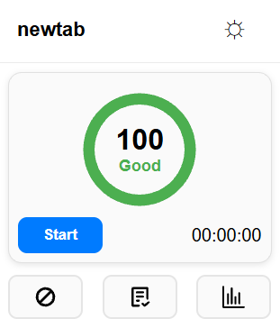

# FocusFlowTracker
Focus Flow Tracker is a chrome extension designed to help users stay focused and productive. This is accomplished through a variety of features.
* Distraction score that goes down when the user changes tabs
* Page warnings that warn the users when they visit problem pages
* Page blocker that stops users from accessing a page at all
* Time tracking so users know how long they've been working
* Usage statistics for all the sites visited and frequency of visits
* Notes page that allows downloadable txt files
* Ad blocking while tracking is active

Our main goal with this product is to help users develop healthy digital habits and make the most out of their time.

## Group Members
Davyn Mengeling [DMengeli04](https://github.com/DMengeli04)

Siddh Patel [spatel787](https://github.com/spatel787)

Alex Rother [alexrother](https://github.com/alexrother)

Manihams Suraparaju [manihams](https://github.com/manihams)

Jeffrey Wiggs [UltraStarcastic](https://github.com/UltraStarcastic)
